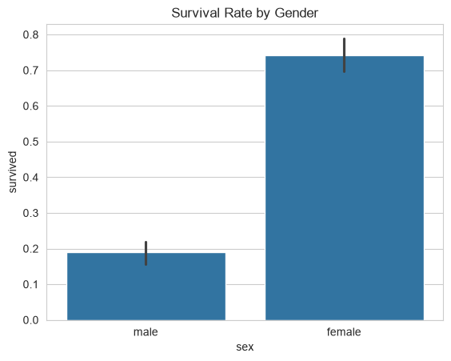
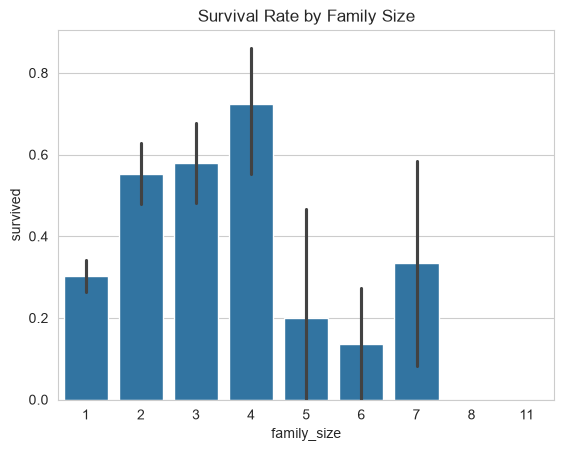

# 🚢 Titanic Dataset – Exploratory Data Analysis (EDA)

<p align="center">
  <strong>SWYNEX Data Analytics Internship Project</strong>
</p>

<p align="center">
  
  
  
  
</p>

---

## 📌 Project Overview

This project focuses on performing Exploratory Data Analysis (EDA) on the Titanic passenger dataset.

The main objective is to explore passenger information, identify survival patterns, understand relationships between variables, and detect anomalies using Python libraries.

## 🎯 Project Objectives

- Understand the Titanic dataset.
- Perform data exploration and analysis.
- Identify missing values and anomalies.
- Analyze passenger survival patterns.
- Visualize relationships between different attributes.
- Extract meaningful insights from the dataset.

## 📂 Dataset Information

| Details | Description |
|---|---|
| Dataset | Titanic Dataset |
| Total Records | 891 passengers |
| Total Columns | 13 |
| Target Variable | Survived |
| Dataset File | titanic_cleaned.csv |

## 🛠️ Technologies Used

| Technology | Purpose |
|---|---|
| Python | Programming |
| Pandas | Data manipulation and analysis |
| NumPy | Numerical operations |
| Matplotlib | Data visualization |
| Seaborn | Statistical visualization |
| Jupyter Notebook | Development environment |

## 📊 Data Visualizations

The following visualizations were created to understand passenger survival patterns.

### 1. Survival Analysis


### 2. Gender-Based Survival


### 3. Passenger Class Analysis


### 4. Age Distribution


### 5. Fare Outlier Detection


### 6. Correlation Heatmap


### 7. Family Size Analysis


## 🔍 Key Insights

| Factor | Key Finding |
|---|---|
| Passenger Class | First class: 63.0%, Second class: 47.3%, Third class: 24.2% survival |
| Gender | Women: 74.2%, Men: 18.9% survival |
| Family Size | Families of 2–4 had better survival rates |
| Fare | 116 high-fare outliers were identified |
| Age | Young children showed better survival chances |
| Correlation | Survival correlated negatively with Pclass (-0.34) and positively with Fare (+0.26) |

### 💡 Important Findings

- Gender was one of the strongest factors associated with survival.
- First-class passengers had better survival chances than third-class passengers.
- Passengers travelling in small families generally had better survival rates.
- Fare distribution contained extreme high-value outliers.
- Children showed better survival chances than many adult age groups.

## 💡 Conclusion

The analysis reveals that gender, passenger class, age, family size, and ticket fare were important factors associated with Titanic passenger survival.

Data visualization helped identify meaningful patterns, relationships, and anomalies in the dataset.

This project provided practical experience in Python programming, data cleaning, exploratory data analysis, and data visualization.

## ▶️ How to Run the Project

**Step 1: Install the required libraries**

```bash
py -m pip install pandas numpy matplotlib seaborn notebook
```

**Step 2: Open the project folder**

Navigate to the downloaded project folder.

**Step 3: Launch Jupyter Notebook**

```bash
jupyter notebook
```

**Step 4: Run the notebook**

Open `eda.ipynb` and execute all cells.

## 📁 Project Structure

```text
SWYNEX-Exploratory-Data-Analysis/
│
├── README.md
├── eda.ipynb
│
├── data/
│   └── titanic_cleaned.csv
│
└── images/
    ├── 1_survival.png
    ├── 2_gender.png
    ├── 3_class.png
    ├── 4_age.png
    ├── 5_fare_outliers.png
    ├── 6_heatmap.png
    └── 7_family.png
```

## 👩‍💻 Project Information

**Project:** Titanic Exploratory Data Analysis

**Organization:** SWYNEX

**Domain:** Data Analytics

**Tools:** Python, Pandas, NumPy, Matplotlib, Seaborn, Jupyter Notebook

---

<p align="center">
  <strong>✨ Turning Data into Meaningful Insights! ✨</strong>
</p>
